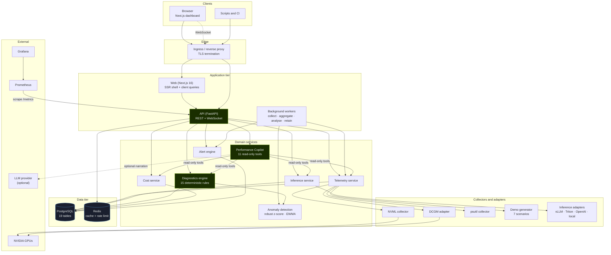
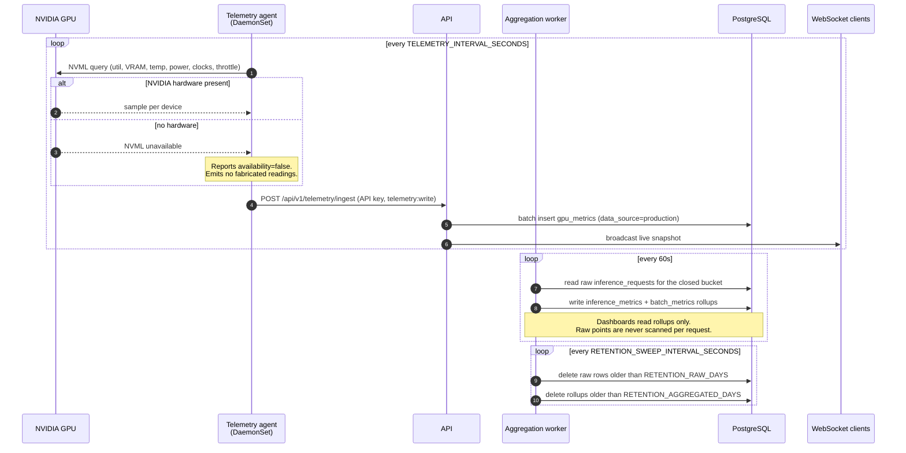
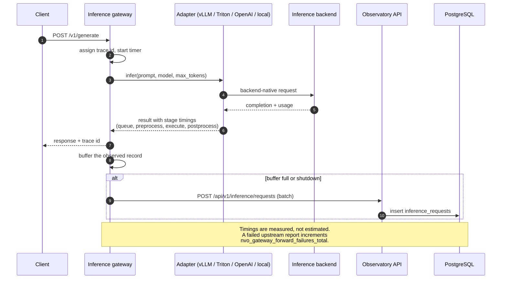
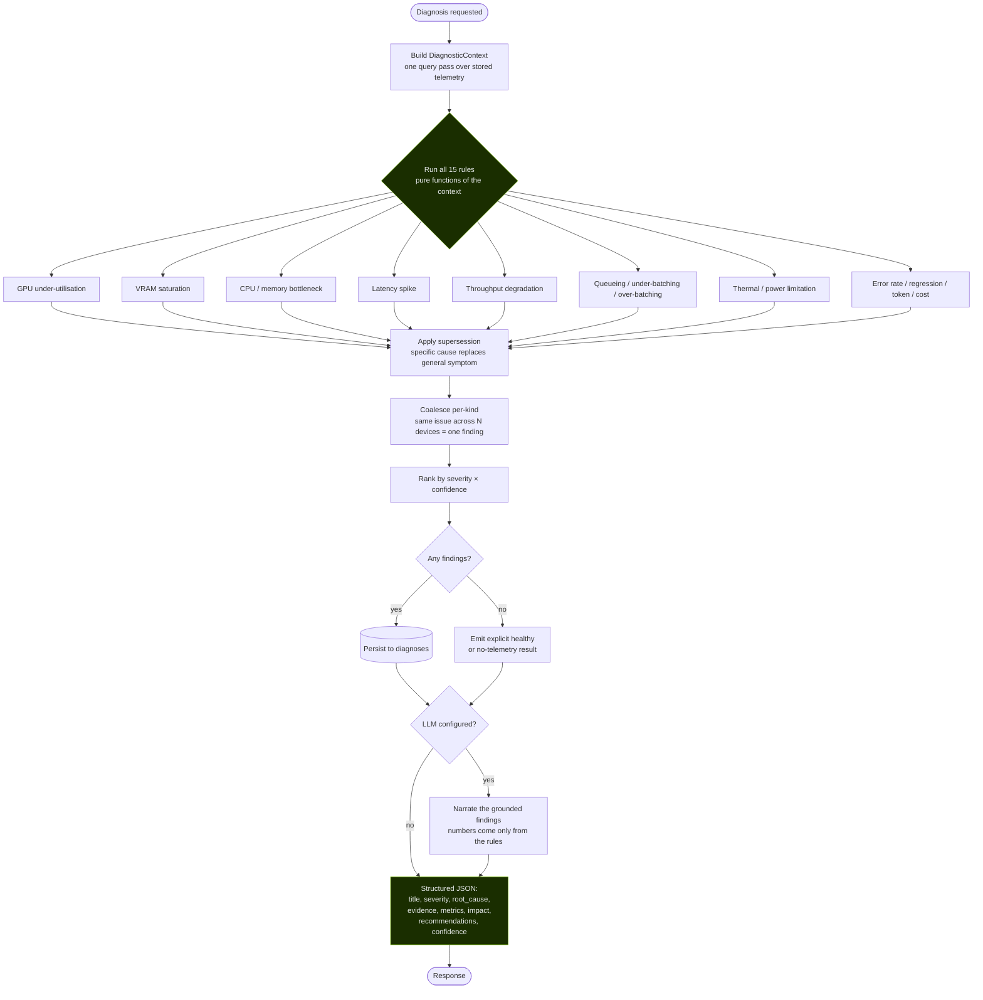
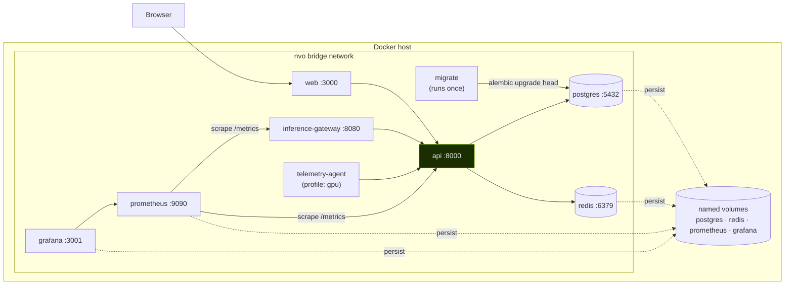
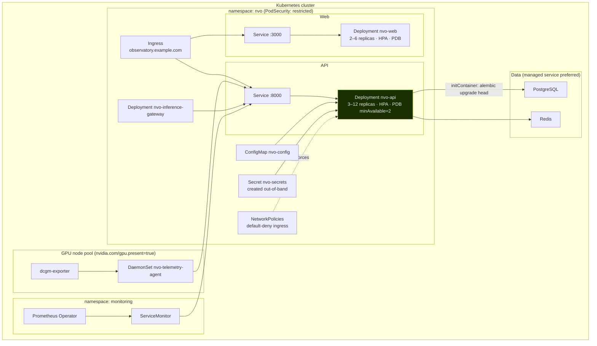

# Architecture

## Design principles

Four constraints shaped every decision in this codebase.

**1. Measurements are never invented.** Every number the platform displays is
traceable to a stored sample. When a metric has not been measured, the API
returns `null` and the UI renders an em dash — never `0`. When no NVIDIA GPU is
present, the API says so explicitly rather than producing plausible-looking
hardware statistics.

**2. Synthetic data is quarantined.** Every telemetry row carries a
`data_source` discriminator of `production` or `demo`. Every read path filters
on it, and the UI labels demo data persistently. Demo telemetry therefore
cannot be presented as production telemetry.

**3. Diagnosis is deterministic first.** Root-cause findings come from a
rules engine operating on stored measurements. A language model, when
configured, adds narration on top of those findings. It never supplies the
numbers, and the platform is fully functional with no LLM configured at all.

**4. The agent has no dangerous capability.** The agent's tool registry
contains only read-only queries. There is no tool to execute a command, write
to the database, or read configuration. This is enforced by the absence of the
capability, not by an instruction in a prompt.

---

## 1. System architecture

---

## 2. Telemetry flow

---

## 3. Inference request flow

---

## 4. AI diagnosis flow

---

## 5. Database entity relationships

```mermaid
erDiagram
    users ||--o{ api_keys : owns
    users ||--o{ refresh_tokens : holds
    gpus ||--o{ gpu_metrics : samples
    gpus ||--o{ gpu_processes : hosts
    ml_models ||--o{ deployments : "deployed as"
    gpus ||--o{ deployments : runs
    deployments ||--o{ inference_requests : serves
    deployments ||--o{ inference_metrics : "rolled up into"
    deployments ||--o{ batch_metrics : "batching for"
    ml_models ||--o{ inference_requests : identifies
    alert_rules ||--o{ alerts : fires
    deployments ||--o{ workloads : "load against"

    users {
        string id PK
        string email UK
        string hashed_password
        string role
        bool is_active
    }
    api_keys {
        string id PK
        string key_hash UK
        string scopes
        string owner_id FK
    }
    gpus {
        string id PK
        string uuid
        int index
        string data_source
        float total_memory_mb
    }
    gpu_metrics {
        string id PK
        string gpu_id FK
        datetime recorded_at
        string data_source
        float utilization_pct
        float memory_utilization_pct
        float temperature_c
        float power_w
    }
    system_metrics {
        string id PK
        string host
        datetime recorded_at
        string data_source
        float cpu_utilization_pct
        float ram_utilization_pct
    }
    ml_models {
        string id PK
        string name
        string version
        string quantization
        int max_batch_size
        string data_source
    }
    deployments {
        string id PK
        string model_id FK
        string gpu_id FK
        int max_batch_size
        float batch_window_ms
        string data_source
    }
    inference_requests {
        string id PK
        string deployment_id FK
        datetime started_at
        float total_latency_ms
        int batch_size
        bool is_error
        string data_source
    }
    inference_metrics {
        string id PK
        string deployment_id FK
        datetime bucket_start
        float p95_latency_ms
        float requests_per_second
        float tokens_per_second
        string data_source
    }
    batch_metrics {
        string id PK
        string deployment_id FK
        datetime bucket_start
        float avg_batch_size
        float batch_efficiency
        float queue_depth
    }
    anomalies {
        string id PK
        datetime detected_at
        string metric_kind
        string severity
        float observed_value
        float score
    }
    alerts {
        string id PK
        string rule_id FK
        string state
        string severity
        datetime triggered_at
    }
    diagnoses {
        string id PK
        string kind
        string severity
        text evidence
        text recommendations
        float confidence
    }
    pricing_profiles {
        string id PK
        float cost_per_gpu_hour
        string currency
        bool is_default
    }
    workloads {
        string id PK
        string profile
        string status
        int requests_generated
    }
    audit_logs {
        string id PK
        datetime occurred_at
        string action
        string outcome
    }
```

---

## 6. Deployment architecture (Docker Compose)

---

## 7. Kubernetes architecture

---

## Module layout

| Path | Responsibility |
|---|---|
| `apps/api/app/core/` | Config, logging, security, RBAC, cache, middleware, metrics, errors |
| `apps/api/app/db/` | Declarative base, `UTCDateTime` type, async session management |
| `apps/api/app/models/` | 19 SQLAlchemy models |
| `apps/api/app/schemas/` | Pydantic request/response contracts |
| `apps/api/app/collectors/` | NVML, DCGM, psutil collectors behind one interface |
| `apps/api/app/services/` | Telemetry, inference, cost, alerts, comparison, anomalies |
| `apps/api/app/services/diagnostics/` | Context builder, 15 rules, orchestration engine |
| `apps/api/app/agents/` | LLM providers, tool registry, prompt guard, Copilot |
| `apps/api/app/inference/` | vLLM, Triton, OpenAI-compatible and local adapters |
| `apps/api/app/demo/` | 7 scenarios, generator, runtime and backfill |
| `apps/api/app/realtime/` | WebSocket manager and background worker supervisor |
| `apps/api/app/api/v1/` | HTTP routers |
| `apps/web/app/` | 11 routes (10 dashboard pages + login) |
| `apps/web/components/` | UI primitives, state components, charts, shell |
| `apps/web/hooks/` | TanStack Query hooks, one per resource |
| `services/` | Telemetry agent, inference gateway, workload generator |
| `infra/` | Docker, Kubernetes, Helm, Prometheus, Grafana |

## Key architectural decisions

**Bucketed aggregation, not raw scans.** `resolve_range()` selects a bucket
width that keeps any series under ~720 points. Dashboards read
`inference_metrics` rollups; the raw `inference_requests` table is only touched
for the request detail table and the latency histogram.

**Portable timestamps.** A `UTCDateTime` type decorator normalises every
datetime to timezone-aware UTC on both bind and result. SQLite drops `tzinfo`
on round-trip, which otherwise produces naive/aware comparison crashes at
runtime — this removes the entire class of bug in one place.

**Cache degradation.** Redis is preferred; if it is unreachable at startup the
platform falls back to an in-process cache and logs the downgrade. Readiness
treats the database as the only hard dependency.

**Rules before models.** The diagnostics engine is a pure function of an
explicitly assembled context. This makes it unit-testable against known inputs,
reproducible, and auditable — properties no LLM-only design provides.
